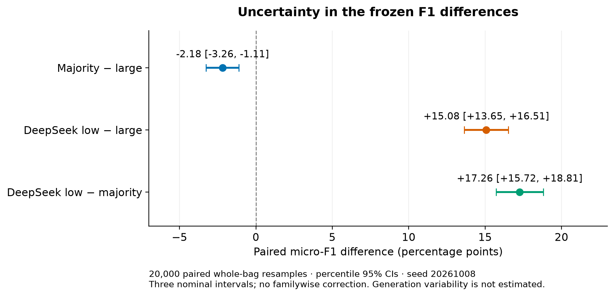
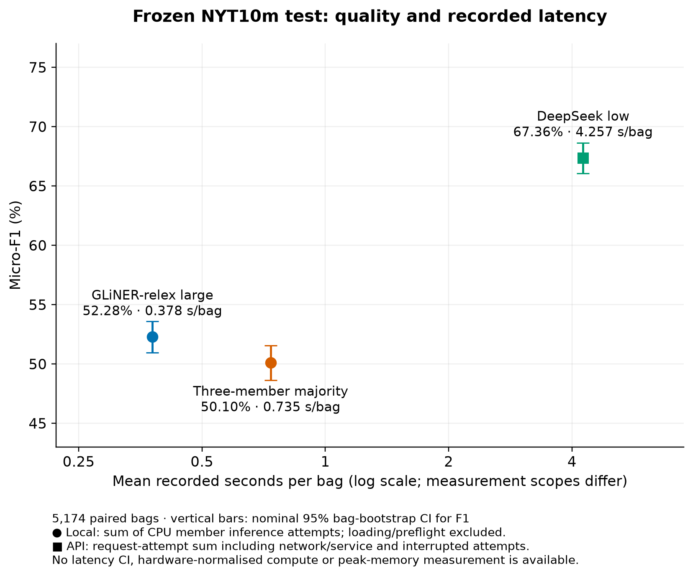
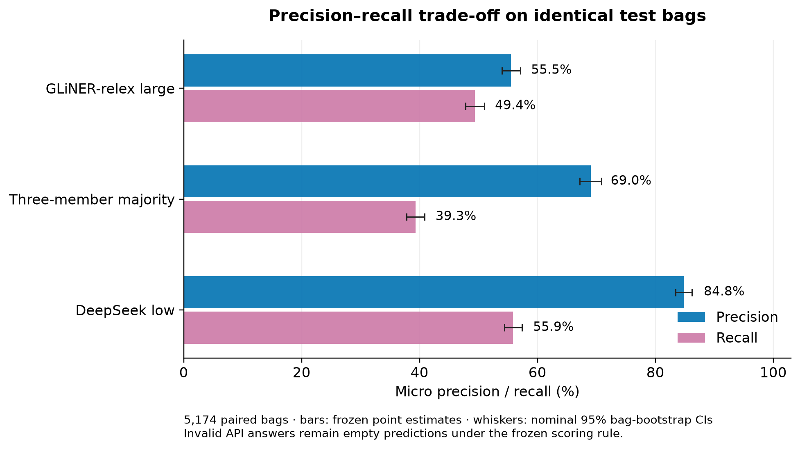

# Results across four frozen test studies

The released-model analysis was completed on 8 October 2026 using saved predictions. No new API requests, model inference, threshold selection or reference changes occurred. The [analysis notebook](../source/Test_results_analysis.ipynb) displays all tables, examples and figures without data or checkpoints. The [statistical report](../results/test_statistical_analysis_20261008.json) and [11 KB count archive](../results/test_bag_counts_20261008.npz) preserve the numerical analysis.

## Paired uncertainty analysis

The same 5,174 official manual-test bags are resampled with replacement for all three frozen systems, keeping each bag's complete label set together. For each of 20,000 replicates, seed `20261008`, micro-F1 is recomputed from summed TP/FP/FN. Neither sentences nor individual labels are resampled; bag-level F1 values are not averaged. Negative bags and invalid API responses remain included. The count archive stores sufficient statistics for this paired analysis without texts, names or entity IDs.

| Frozen contrast | Micro-F1 difference (percentage points) | Paired 95% percentile CI |
|---|---:|---:|
| Majority − large | −2.18 | [−3.26, −1.11] |
| DeepSeek low − large | +15.08 | [+13.65, +16.51] |
| DeepSeek low − majority | +17.26 | [+15.72, +18.81] |

All three intervals exclude zero. These are nominal intervals without familywise multiplicity adjustment. They quantify sampled-bag uncertainty conditional on fixed predictions, references and configurations; they do not measure repeated API-generation variation, annotation uncertainty, training variation or configuration-search uncertainty. Approximate bag exchangeability is assumed; shared entities or articles may create dependencies not represented by this ordinary bootstrap. Descriptive relation-level results below have no class-specific intervals.

## Quality and latency

| Frozen system | Precision | Recall | Micro-F1 [95% CI] | Mean recorded seconds/bag |
|---|---:|---:|---:|---:|
| GLiNER-relex large0.7 | 55.52% | 49.40% | 52.28% [50.96, 53.59] | 0.378 |
| Majority base0.5 / large0.7 / GLiDRE0.7 | 69.02% | 39.32% | 50.10% [48.62, 51.57] | 0.735 |
| DeepSeek thinking-low | 84.81% | 55.86% | 67.36% [66.07, 68.64] | 4.257 |

The ensemble has lower micro-F1 and requires 1.94× large's local inference time. The paired interval supports the observed deficit within the bootstrap assumptions. This is evidence against the tested majority at the primary F1/time objective; it is not evidence against every possible ensemble. Its improved precision could matter under another explicitly defined error-cost objective, which is not evaluated here.

DeepSeek has higher measured precision, recall and F1. Its request-attempt time is 11.25× large's CPU inference sum, but these have different measurement scopes and do not establish an intrinsic compute-speed ratio. The 78 invalid/truncated completions remain failures under the frozen rule.

## DeepSeek-relative reporting

The thesis uses DeepSeek thinking-low as the empirical upper quality reference normalized to **100**. Derived from the exact metrics in [test_comparison_summary.json](../results/test_comparison_summary.json), `100 × micro-F1(system) / 0.6735735271377764` gives:

| Completed frozen system | Absolute micro-F1 | DeepSeek-relative F1 |
|---|---:|---:|
| GLiNER-relex large0.7 | 0.5228 | 77.62 |
| Three-member majority | 0.5010 | 74.38 |
| DeepSeek thinking-low | 0.6736 | 100.00 |

These are reporting transformations of saved results, not new predictions, perfect F1, a mathematical ceiling or normalized confidence intervals. Retain absolute metrics and the existing paired uncertainty analysis. The [protocol](protocol.md#deepseek-relative-f1) requires matched cohorts/references and forbids using the test denominator for validation.

## Lost and recovered relations

Relative to large, voting changes 1,200 bags. It removes 468 correct facts and 897 false positives, while adding 75 correct facts and 42 false positives. Net: 393 fewer TP and 855 fewer FP. A label accepted only by large is removed because neither other member supports it. A correct label absent from large is recovered only when base and GLiDRE both accept it.

| Relation | Correct facts lost | Correct facts recovered | Net TP | FP removed | FP added |
|---|---:|---:|---:|---:|---:|
| Location contains | 276 | 2 | −274 | 145 | 0 |
| Country administrative divisions | 89 | 0 | −89 | 181 | 0 |
| Person/company | 3 | 30 | +27 | 5 | 1 |
| Place of death | 2 | 17 | +15 | 18 | 1 |
| Place lived | 12 | 16 | +4 | 14 | 2 |
| Children | 12 | 1 | −11 | 3 | 0 |
| Nationality | 17 | 2 | −15 | 26 | 13 |

Containment and country administrative divisions account for 365/468 rejected correct facts (78.0%). Person/company, place of death and place lived account for 63/75 recoveries (84.0%). The improvement in selected relation types does not offset the containment-related recall loss overall.

Two deterministic single-sentence examples illustrate the mechanism. For **Atlanta → Sweet Auburn**, the sentence identifies “the Sweet Auburn neighborhood in Atlanta”; the official relation is `contains`. Large accepts it; base and GLiDRE return empty sets, so majority loses a correct relation. For **David Brooks → The New York Times**, the sentence explicitly identifies Brooks as “a columnist for The New York Times”. Large returns an empty set; base and GLiDRE agree on `person/company`, recovering the official relation. Complete selected sentences and accepted labels are available in the notebook and JSON. These are diagnostic illustrations, not additional adjudication or method-selection evidence.

## Separate cost dimensions

| Dimension | Large | Majority | DeepSeek low |
|---|---:|---:|---:|
| Local CPU inference-attempt sum | 1,957.52 s / 32.63 min | 3,803.89 s / 63.40 min | Not applicable |
| API request-attempt sum | Not applicable | Not applicable | 22,023.95 s / 6.12 h |
| Reconstructed API charge | Not applicable | Not applicable | USD 2.40966831 |
| Unknown-charge reserve | Not applicable | Not applicable | USD 0.01210260 |
| Peak local runtime memory | Not measured | Not measured | Provider memory unavailable |

Local timing includes all required member inference attempts and session label encoding, excluding loading and preflight. API timing includes network/service and the two interrupted attempts, excluding idle gaps and backoff; it is not elapsed start-to-finish time. API usage plus reserve is USD 2.42177091; the reserve is not a known charge and reconstructed expenditure is not an invoice. Local monetary and energy costs were not measured. Missing memory is recorded as `null`, not zero; checkpoint size is not substituted for peak memory. No combined quality-per-dollar or memory-efficiency claim is made.

## Reproduction and checks

The new analysis is separate from the nine hash-bound inference sources. It validates the frozen specification, inputs, references, all 15,522 encoder caches, 5,174 API responses, response journals, primary counts, timing and transition diagnostics. A 25,878-file saved-input/cache/journal inventory hash is recorded. The published report's point estimates match the earlier summaries exactly.

[analyze_test_results.py](../source/analyze_test_results.py) exports the compact counts and bootstrap report. [plot_test_results.py](../source/plot_test_results.py) exports PNG, SVG and PDF figures with a hash manifest. The notebook defaults to viewing the saved report; optional flags recompute statistics or figures without model execution. Figure regeneration dependencies were installed only in an isolated temporary Python environment, leaving the project environment unchanged. Synthetic tests verify paired indices, whole-bag multilabel contributions, micro aggregation, invalid/negative inclusion, identical-system zero differences and mismatched-support rejection.

## ONNX reduction test: 13 October 2026

The separately frozen [INT8/trio comparison](../results/onnx_reduction_test_spec.json) completed all 5,174 bags with unchanged official selected references. The [summary](../results/onnx_reduction_test_summary.json) and [independent audit](../results/onnx_reduction_test_audit_20261013.json) verify 20,696 valid member caches, 2,000 matched timing observations, complete runtime gates and 20,000 paired whole-bag bootstrap replicates. No new API call or test-driven method revision occurred.

| System | TP | FP | FN | Precision (%) | Recall (%) | Micro-F1 (%) |
|---|---:|---:|---:|---:|---:|---:|
| ONNX FP32 | 1774 | 1229 | 2125 | 59.07 | 45.50 | 51.41 |
| Dynamic INT8 | 1784 | 1182 | 2115 | 60.15 | 45.76 | 51.97 |
| INT4 weight-only | 1639 | 1139 | 2260 | 59.00 | 42.04 | 49.09 |
| Mixed FP16 | 1774 | 1227 | 2125 | 59.11 | 45.50 | 51.42 |
| Mean INT8 + INT4 + FP16 | 1729 | 1143 | 2170 | 60.20 | 44.34 | 51.07 |
| Historical PyTorch large | 1926 | 1543 | 1973 | 55.52 | 49.40 | 52.28 |
| DeepSeek low (saved) | 2178 | 390 | 1721 | 84.81 | 55.86 | 67.36 |

INT8 exceeds the matched ONNX FP32 control by +0.57 F1 points [0.16,0.98]. The equally weighted INT8/INT4/FP16 mean is −0.90 points below INT8 [−1.36,−0.46]. The mean loses 75 correct relations and recovers 20. It removes 94 false positives and adds 55. Precision is virtually unchanged while recall falls. Dominant net losses are containment(−29 TP) and residence(−20). Intervals are nominal, unadjusted for five prespecified contrasts and conditional on saved outputs/approximately exchangeable bags.

Relative to matched ONNX FP32, INT8 reduces repeated 100-bag latency by 17.99%, benchmark sampled RSS by 41.02% and deployment file bytes by 48.09%. Full cached inference instead records 4.90% less time and 35.67% less quality-phase peak RSS; these different input/measurement windows remain separate. The trio costs 11.87× INT8's benchmark time and stores 2.608 GiB versus 0.909 GiB; joint deployed RAM is unmeasured. Its sequential time is estimated from aligned member runs, not measured deployed execution.

The historical PyTorch large and current ONNX FP32 are **not an isolated backend contrast**. The earlier runner passes source relation-description order; the precision worker uses JSON-sorted description order. GLiNER prepends that ordered prompt list to the encoded input. Their label set/descriptions, weights, evidence and official reference agree, but serialization differs. The observed 52.28% versus 51.41% F1 difference cannot be assigned solely to export/backend. Its causal components were not isolated; all current precision variants share the same ordering and their matched contrasts remain valid. Existing numerical/native gates were passed under that ordering.

DeepSeek low remains 67.36% F1, including 78 invalid outputs. Its matched relative index100 gives INT8 77.16 and the trio 75.82. Historical API expenditure of approximately USD 2.41 and request latency remain separate from local inference, memory and storage. This completed precision-only ensemble does not justify its additional latency under the prespecified F1/time objective; the finding does not rule out ensembles with genuinely different trained members.

## LoRA official test — 19 October 2026

Both placements completed three epochs. The frozen comparison uses Last6 epoch 2 and Random6 epoch 3. The [summary](../results/lora_test_summary_20261019.json) and [audit](../results/lora_test_audit_20261019.json) document 15,522 cached local results, the matched original-large control and the saved DeepSeek reference.

| System | TP | FP | FN | Micro-F1 |
|---|---:|---:|---:|---:|
| Matched original large | 1,926 | 1,543 | 1,973 | 52.28% |
| Last6 | 1,904 | 664 | 1,995 | 58.88% |
| Random6 | 1,950 | 817 | 1,949 | 58.51% |
| LoRA union | 2,087 | 902 | 1,812 | 60.60% |
| LoRA intersection | 1,767 | 579 | 2,132 | 56.59% |
| Saved DeepSeek low | 2,178 | 390 | 1,721 | 67.36% |

Last6 gains 6.60 F1 points over matched original large, with a nominal paired interval of [+5.34, +7.88]. False positives fall from 1,543 to 664, while true positives fall from 1,926 to 1,904. Union gains another 1.71 points [+1.11, +2.33] at about 1.95× Last6's estimated sequential inference time. The Random6–Last6 interval spans zero.

Measured mean warmed CPU time per bag was 0.4610 s for original large, 0.4775 s for Last6 and 0.4543 s for Random6. Union's 0.9317 s is their adapter-member sum. The one-off Last6 and Random6 training sessions took 5.82 h and 10.32 h respectively, reported separately from inference.

## Heuristic fusion official test — 22 October 2026

The [completed summary](../results/heuristic_ensembles_test_summary_20261022.json) and [audit](../results/heuristic_ensembles_test_audit_20261023.json) retain all 14 declared conditions. Pair names below indicate fusion with Last6. Its saved scores reproduce the earlier Last6 result.

| System | TP | FP | FN | Micro-F1 |
|---|---:|---:|---:|---:|
| Last6 | 1,904 | 664 | 1,995 | 58.88% |
| GLiClass | 1,851 | 1,775 | 2,048 | 49.20% |
| NLI >0.9 | 1,652 | 3,405 | 2,247 | 36.89% |
| NLI >0.7 | 2,489 | 9,260 | 1,410 | 31.81% |
| GLiClass union | 2,485 | 2,200 | 1,414 | 57.90% |
| NLI union | 2,376 | 3,895 | 1,523 | 46.73% |
| GLiClass equal mean | 1,815 | 417 | 2,084 | 59.21% |
| NLI equal mean | 2,027 | 471 | 1,872 | 63.37% |
| GLiClass weighted | 1,851 | 476 | 2,048 | 59.46% |
| GLiClass selective add | 1,975 | 716 | 1,924 | 59.94% |
| GLiClass selective replace | 1,973 | 710 | 1,926 | 59.95% |
| NLI weighted | 1,972 | 478 | 1,927 | 62.12% |
| NLI selective add | 1,975 | 722 | 1,924 | 59.88% |
| NLI selective replace | 1,973 | 715 | 1,926 | 59.91% |

The NLI equal mean gains 4.49 F1 points over Last6 [+3.50, +5.50] and reaches 94.09 on the empirical DeepSeek-relative index. Its estimated sequential mean is 2.4830 s per bag, compared with 0.4775 s for Last6 alone. The member sum excludes fusion overhead and joint RSS remains unmeasured. The weighted NLI variant reaches 62.12% F1, and selective add/replace variants yield smaller gains. The test retained all controls and variants as declared.

This late study reused a previously inspected benchmark. Its nominal paired intervals condition on the fixed predictions and omit multiplicity and design-reuse adjustments. The same score, time and memory boundaries apply when comparing with earlier studies. See the [protocol](protocol.md#heuristic-fusion) and [result inventory](../results/README.md).
